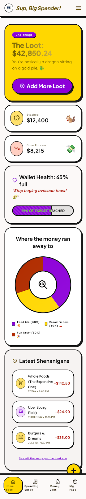
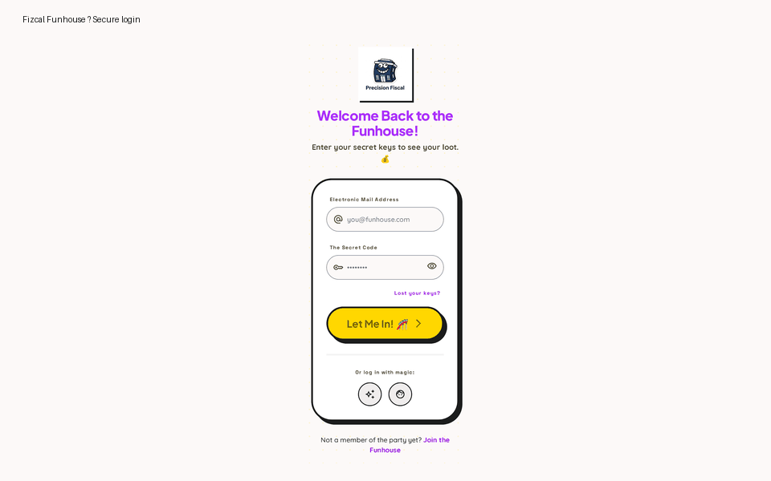
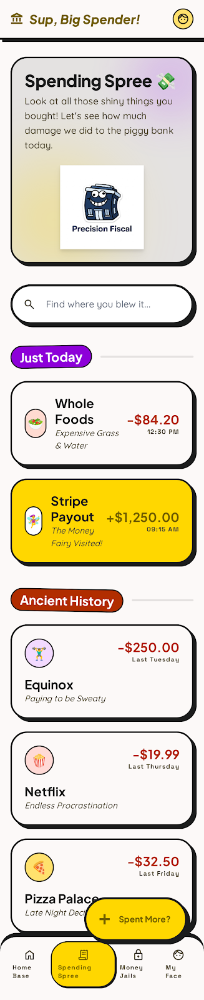
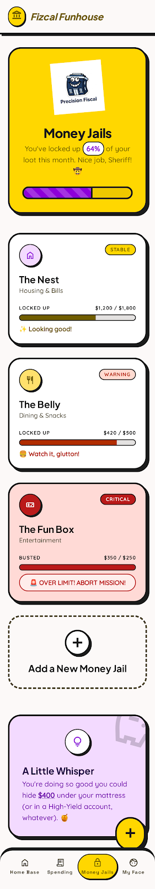
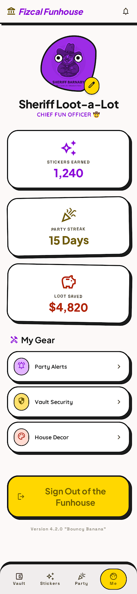
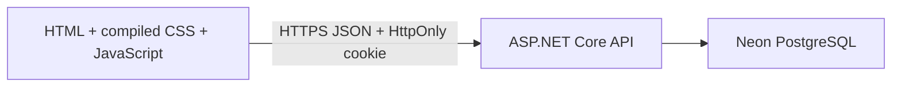

# Fizcal Funhouse — Frontend

Playful, responsive personal-finance UI for tracking transactions, category budgets, and monthly progress without the intimidating feel of traditional finance software.



## Demo



| Login | Transactions |
| --- | --- |
|  |  |

| Budgets | Editable profile |
| --- | --- |
|  |  |

## Architecture



## Stack and features

- Semantic HTML, vanilla JavaScript, compiled Tailwind CSS
- Register, login, logout, and password-reset screens
- Real profile-photo upload with client and server validation
- Per-user database-backed notifications with persistent read state
- Loading, empty, validation, and API error feedback
- Responsive navigation, keyboard-friendly controls, labelled forms
- No Tailwind CDN and no secrets in frontend code

## Run locally

```powershell
npm ci
npm run build:css
npm run serve
```

Open `http://127.0.0.1:4173`. During local development the API is expected at `http://127.0.0.1:5287`.

## Browser tests

Playwright covers login, profile editing, notifications, horizontal overflow, and axe accessibility checks on desktop and mobile viewports.

```powershell
npx playwright install chromium
npm run test:e2e
```

## Technical decisions

- Vanilla JavaScript keeps the portfolio easy to inspect, with less component abstraction than a framework.
- The generated CSS is committed so the static site runs without production build tooling.
- JWTs remain in secure HttpOnly cookies; browser JavaScript never stores or reads them.

CI rebuilds CSS, runs Playwright tests, uploads failure reports, and runs a high-severity dependency audit on every push.
